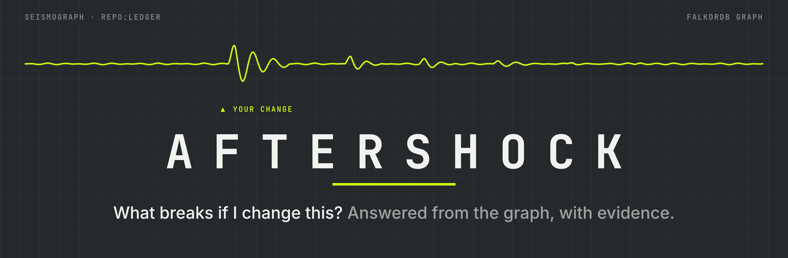
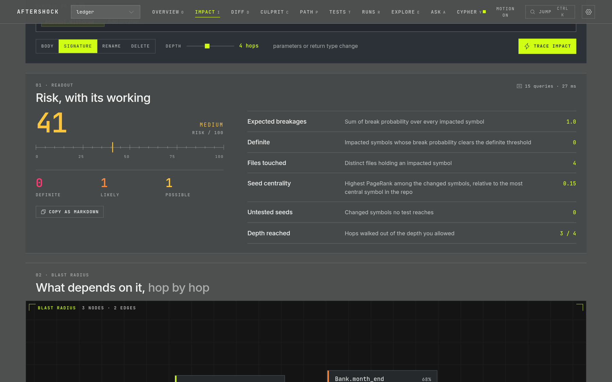
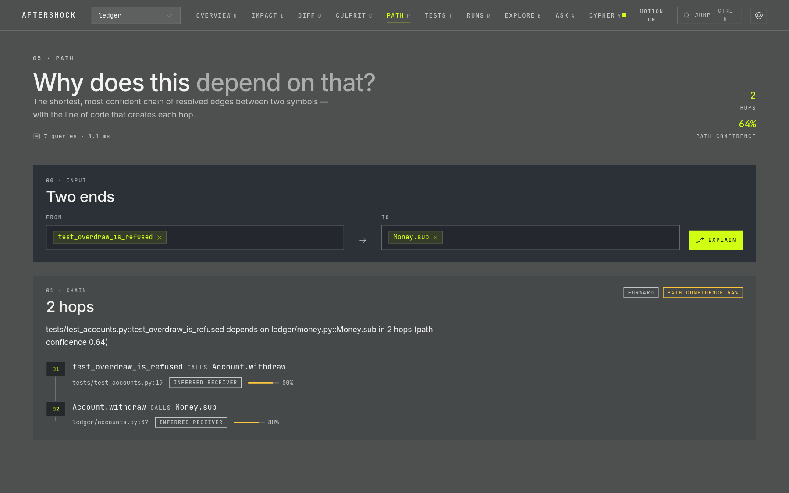
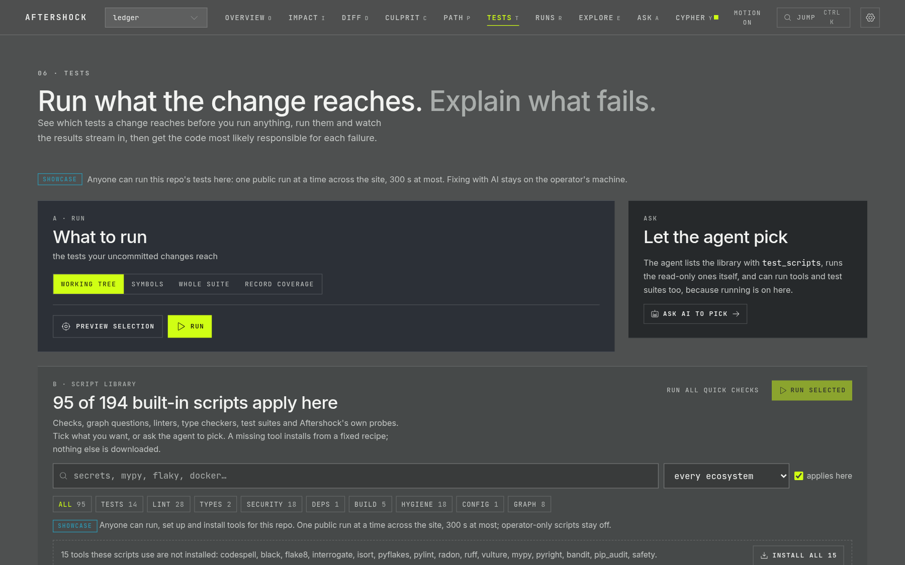
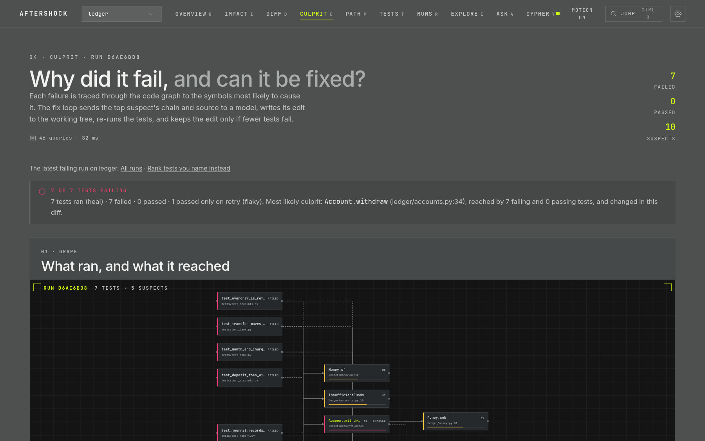
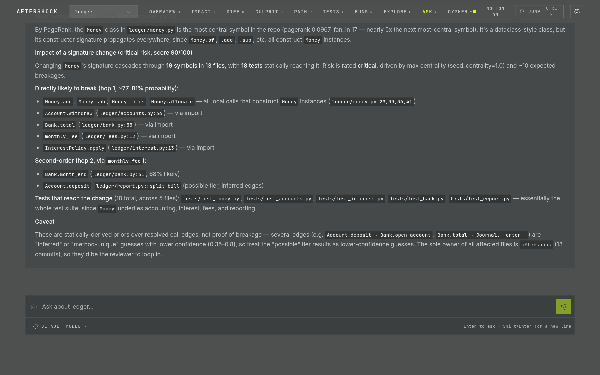
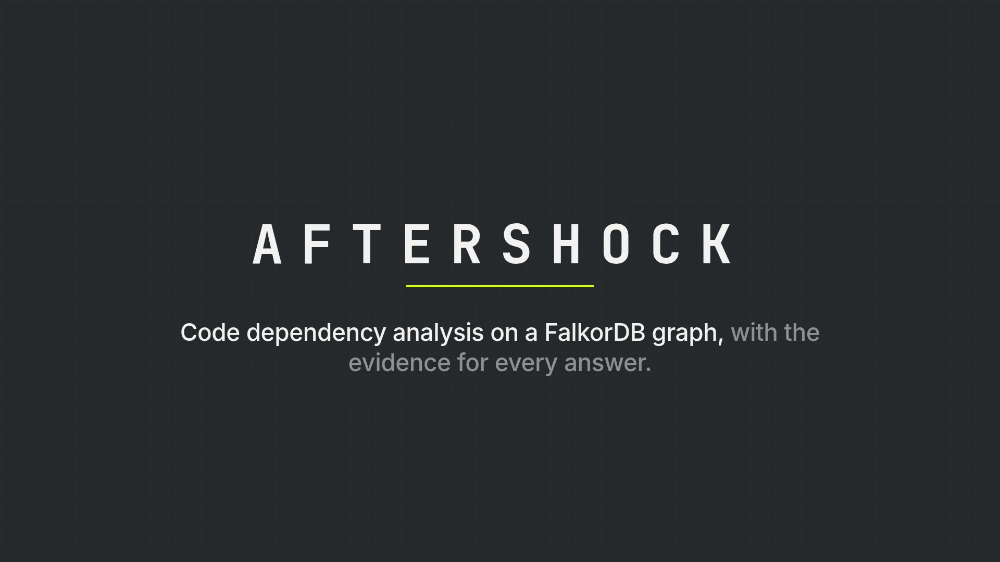

<div align="center">



**Change one line. See everything it shakes loose before it ships.**

Aftershock turns a codebase into a [FalkorDB](https://falkordb.com) graph of every call, import, override and test,
then answers *"what breaks if I change this?"* by walking that graph and showing every hop it took.

[](https://github.com/TheManishCode/aftershocks---Graph-Hacks/actions/workflows/ci.yml)
[](LICENSE)
[](pyproject.toml)
[](https://falkordb.com)
[](#use-it-from-an-agent)

[**Live demo**](https://aftershock.manishp.dev) · [Quick start](#quick-start) · [How it works](docs/how-it-works.md) · [Benchmarks](docs/benchmarks.md) · [Architecture](ARCHITECTURE.md) · [Contributing](CONTRIBUTING.md)

</div>

---

## The problem

You rename a parameter. Grep finds the call sites that spell the name the way you expected. It misses the subclass that
overrides the method, the fixture that calls it for forty tests, the `with` block whose type is only known from a
return annotation, and the file that imports the module under an alias. Your CI finds them later, or your users do.

Aftershock reads the code the way the interpreter will run it, records each link in a graph, and gives every answer
with its receipts:

```console
$ aftershock path shop get_user connect
**get_user depends on connect in 2 hops (path confidence 0.81)** — call chain:

1. `get_user` (shop/api.py:4) **calls** `load_user` (shop/service.py:4) — resolved module-attr, confidence 0.90
2. `load_user` (shop/service.py:4) **calls** `connect` (shop/db.py:12) — resolved import, confidence 0.90
```

Each hop names the line, how the edge was resolved, and how far to trust it. The output is markdown, so it pastes
straight into a PR review. (Real output from the test fixture in `tests/fixtures/mini`.)

## What you can ask it

| You want to know | CLI | Web | MCP tool |
|---|---|---|---|
| What breaks if I delete, rename, re-sign or rewrite `X`? | `impact` | Impact | `impact` |
| What does my working tree or PR break? | `diff`, `ci` | Diff | `diff_impact` |
| Which tests should I run for this change? | `tests`, `run` | Tests | `select_tests` |
| Why does `A` depend on `B` at all? | `path` | Path | `explain_path` |
| These tests fail. Which code is to blame? | `culprit` | Culprit | `culprit` |
| …and can a model fix it, proven by a re-run? | `heal` | Fix with AI | — |
| What ran, what failed, what was retried? | `runs` | Runs | `test_runs`, `run_detail` |
| What's load-bearing, cyclic, hot or dead? | `overview` | Overview | `overview` |
| Who should review this? | — | — | `owners` |
| Anything, in plain English | `ask` | Ask | — |
| Raw read-only openCypher | — | Cypher | `cypher` |
| Lint, type-check, secrets, config, test suites: one click | `scripts` | Script library | `run_checks` |
| How accurate is all this on *my* repo? | `eval`, `mutate`, `testlab` | — | — |

Every command takes `--json`. The REST API under `/api/v1` mirrors all of it; the full mapping is in
[How it works](docs/how-it-works.md).

## A tour

The screenshots below are from the [live demo](https://aftershock.manishp.dev) on `ledger`, a small accounting repo
with one real uncommitted change: `Account.withdraw` gains a required `approved_by` argument.

### Impact: the blast radius, scored

Pick a symbol and the kind of change. Aftershock walks reverse dependencies with weights that depend on the change kind,
how each call was resolved and the edge type. It checks each caller's argument count against the new signature,
follows overrides both ways, and rolls the result into a 0–100 risk score with *definite / likely / possible* tiers.



### Path: why does this depend on that?

The shortest, most confident chain of resolved edges between two symbols, with the line that creates each hop.
Paste the URL into a review and it re-runs itself.



### Tests → Culprit → Fix with AI

Run only the tests the change reaches and watch results stream in. When something fails, the run opens as a graph of
what ran and what it reached, with suspects ranked by Ochiai suspiciousness (on recorded coverage when there is
some). *Fix with AI* sends the model the failure, the call chain and the source along it, applies the edit, re-runs
for real, and **keeps the edit only if fewer tests fail**.

<table>
<tr>
<td width="50%"></td>
<td width="50%"></td>
</tr>
</table>

### Ask: plain English, real receipts

Common question shapes route straight to the right tool. Anything else goes to a model that calls the same tools as
the MCP server in a bounded loop and answers from the graph, with the trace shown. Claude by default; OpenAI,
OpenRouter, Groq, Ollama and other OpenAI-compatible providers plug in through one key each.



### See all of it in 97 seconds

[](media/brag.mp4)

One real change, followed through all eleven instruments on the live site: real cursor, real typing, real results.
Waiting is fast-forwarded and marked as such. ([`media/brag.mp4`](media/brag.mp4))

## Numbers, honestly

Aftershock measures itself, publishes the misses next to the hits, and ships the harnesses so you can re-run them.

| What | Result | Where |
|---|---|---|
| AI fix loop on 6 planted bugs in `click` | 6 / 6 fixed in one round; whole suite green after; each fix was the exact revert | [heal bench](docs/benchmarks.md#self-healing-on-real-bugs) |
| Test selection vs. real breakage (`click`, 18 killed mutants) | recorded coverage recall .997; static selection .394 at 16.9% of the suite | [mutation](docs/benchmarks.md#real-breakage-mutation) |
| End-to-end scenarios with known answers | QuixBugs 40 / 40, culprit ranked #1 on all 40; ledger 9 / 9 | [testlab](docs/benchmarks.md#end-to-end-the-testlab) |
| Commit replay on 5 repos (2 held out) | ranked top-5 beats the same-directory baseline on 4 of 5 | [replay](docs/benchmarks.md#five-repos-two-of-them-held-out-2026-10-18-200-commits-depth-3) |

And the parts that don't flatter it: on full commit replay, recall is low and the directory baseline wins F1 on some
repos; the *definite* tier never fired; static selection alone misses real breakage that coverage catches. All of
that is in [Benchmarks](docs/benchmarks.md), with the reasons. Run `aftershock eval` on your own repo before trusting
the tiers there.

## Quick start

You need Python 3.12+ and Docker (for FalkorDB).

```bash
git clone https://github.com/TheManishCode/aftershocks---Graph-Hacks aftershock && cd aftershock
docker compose up -d falkordb            # the graph on :6390, FalkorDB browser on :3012
python -m venv .venv && . .venv/bin/activate
pip install -e ".[agent]"

aftershock index ~/code/myrepo            # a local path, or an https GitHub/GitLab/Bitbucket/Codeberg URL
aftershock impact myrepo parse_config --change signature
aftershock diff myrepo                    # what your uncommitted changes break
aftershock ask myrepo "which tests cover parse_config"
```

Indexing is incremental by content hash: re-running `index` re-parses only changed files.

**The full stack** (graph + API + web UI): `cp .env.example .env`, set `AFTERSHOCK_API_KEY`, then `docker compose up -d`
and open <http://localhost:3101>.

**Exit codes** for scripting: `2` bad input, `3` risk gate failed, `4` graph unavailable.

## Put it on every pull request

`aftershock ci` indexes the PR's merge-base in a throwaway worktree, analyzes `HEAD` against it, and exits `3` if the
risk reaches your threshold. The bundled action runs it against a throwaway FalkorDB and keeps one up-to-date comment
on the PR:

```yaml
# .github/workflows/aftershock.yml
on: pull_request
permissions: { contents: read, pull-requests: write }
jobs:
  blast-radius:
    runs-on: ubuntu-latest
    steps:
      - uses: actions/checkout@v4
        with: { fetch-depth: 0 }          # the merge-base and history mining need real history
      - uses: TheManishCode/aftershocks---Graph-Hacks@main
        with: { fail-on: critical }
```

## Use it from an agent

Aftershock is an MCP server. Over stdio for Claude Code, Claude Desktop or Cursor:

```json
{ "mcpServers": { "aftershock": { "command": "aftershock", "args": ["mcp"] } } }
```

The API also serves streamable HTTP at `/mcp` behind the same bearer key. Every tool is read-only and annotated as
such. Tools that execute tests exist only on a stdio server launched with `AFTERSHOCK_ALLOW_RUN=1`, which lets an
agent drive the whole run → culprit → fix loop on your machine.

## How it fits together

```mermaid
flowchart LR
    src["source repo<br/>path or URL"] --> ingest["<b>ingest</b><br/>discover · parse (tree-sitter)<br/>resolve · git history"]
    ingest --> graph[("<b>FalkorDB</b><br/>repo:&lt;name&gt;")]
    graph --> analysis["<b>analysis</b><br/>impact · diff · paths<br/>culprit · heal · evaluate"]
    analysis --> tools["tools.py"]
    tools --> cli["CLI"]
    tools --> api["REST API"]
    tools --> mcp["MCP"]
    tools --> ask["Ask agent"]
    api --> web["web UI<br/>Next.js"]
```

**Languages.** Python, TypeScript/TSX and JavaScript/JSX are tested on real repositories. Go, Java and Rust are parsed
and resolved, but only unit tests cover them so far.

**Runtime evidence.** Static analysis can't see fixtures, registries or duck typing. `aftershock coverage myrepo`
runs the suite once under per-test coverage and adds a `COVERS` edge from each test to every function it actually ran.
On `click`, that takes the tests selected for `wrap_text` from 12 to 122.

Deeper: [How it works](docs/how-it-works.md) for every instrument, [`ARCHITECTURE.md`](ARCHITECTURE.md) for the
code, [`DECISIONS.md`](DECISIONS.md) for why it is built this way.

## Safety

Some features run the indexed repository's own code, so the defaults are conservative:

- Running tests, scripts that execute tools, installs and the fix loop are **off** in the API until the server is
  started with `AFTERSHOCK_ALLOW_RUN=1`, and then work **only from loopback**. The one public exception is the
  repos an operator names as showcase repos, like the live demo's: one capped run at a time, files restored after.
- The fix loop writes files only when asked (`--apply`) and reverts any round that doesn't reduce failures.
- `/cypher` is read-only: write clauses are rejected and queries run with `GRAPH.RO_QUERY` under a timeout.
- The API indexes only paths under `AFTERSHOCK_REPO_ROOTS` and clones only `https` URLs from allow-listed hosts.
- Model keys stay on the server (env or a `0600` file); no route ever returns one.

Never point the run features at code you don't trust. The full model, and how to report a vulnerability, is in
[`SECURITY.md`](SECURITY.md).

## Known limits

Stated so nobody infers more than was measured:

- Reflection, monkey-patching and string-built calls are invisible to static analysis.
- Duck-typed calls with no shared base class are not followed.
- Runtime evidence and `heal` are Python/pytest only.
- On the five repos measured, 31–50% of all call sites resolve, and 53–75% of the calls that stay inside the repo.
  `index` prints both rates for yours.

The full list is in [How it works → Limits](docs/how-it-works.md#limits).

## Repository layout

```
aftershock/
  ingest/        discover → parse (tree-sitter) → resolve → history: builds the graph
  analysis/      impact, diff, paths, culprit, heal, evaluate; weights.json holds the priors
  catalog/       the built-in script library (checks, graph queries, tool commands, probes)
  runtime/       per-test coverage and test execution
  tools.py       one tool layer behind the CLI, API, MCP server and Ask agent
web/             Next.js UI
testlab/         end-to-end scenarios with known answers (ledger, inventory, QuixBugs)
bench/           pinned benchmark repos
scripts/         benchmark, demo and deployment helpers
tests/           pytest suite; tests/fixtures/mini is a repo with a hand-checked call graph
docs/            how it works, benchmarks, assets
```

## Contributing

Bug reports with a reproduction, new testlab scenarios, and language support are the most valuable contributions
right now. [`CONTRIBUTING.md`](CONTRIBUTING.md) covers setup, tests, and what a change needs to carry. Everyone who has
shaped the project is in [`CONTRIBUTORS.md`](CONTRIBUTORS.md). Please read the [Code of Conduct](CODE_OF_CONDUCT.md).

## Acknowledgements

Built for Track 01 of the WeMakeDevs × FalkorDB **Graph Hacks** hackathon, on top of the Epicenter and Tessera
codebases. It stands on [FalkorDB](https://falkordb.com), [tree-sitter](https://tree-sitter.github.io), the
[Model Context Protocol](https://modelcontextprotocol.io) and [QuixBugs](https://github.com/jkoppel/QuixBugs).

## License

[MIT](LICENSE) © 2026 Manish P
